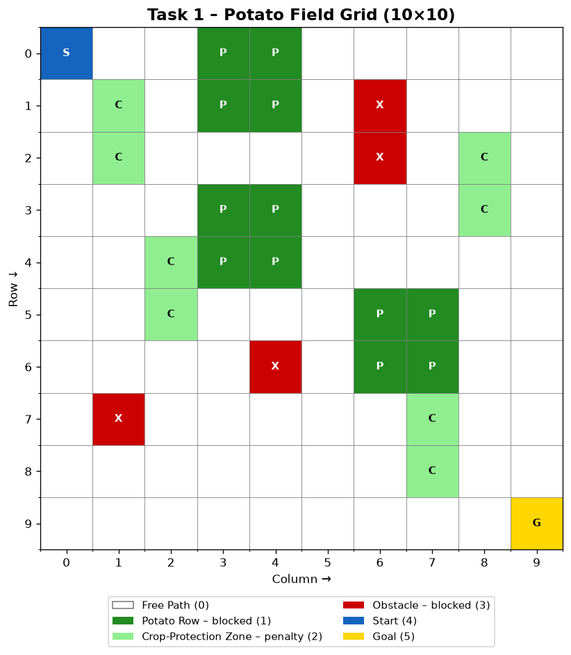
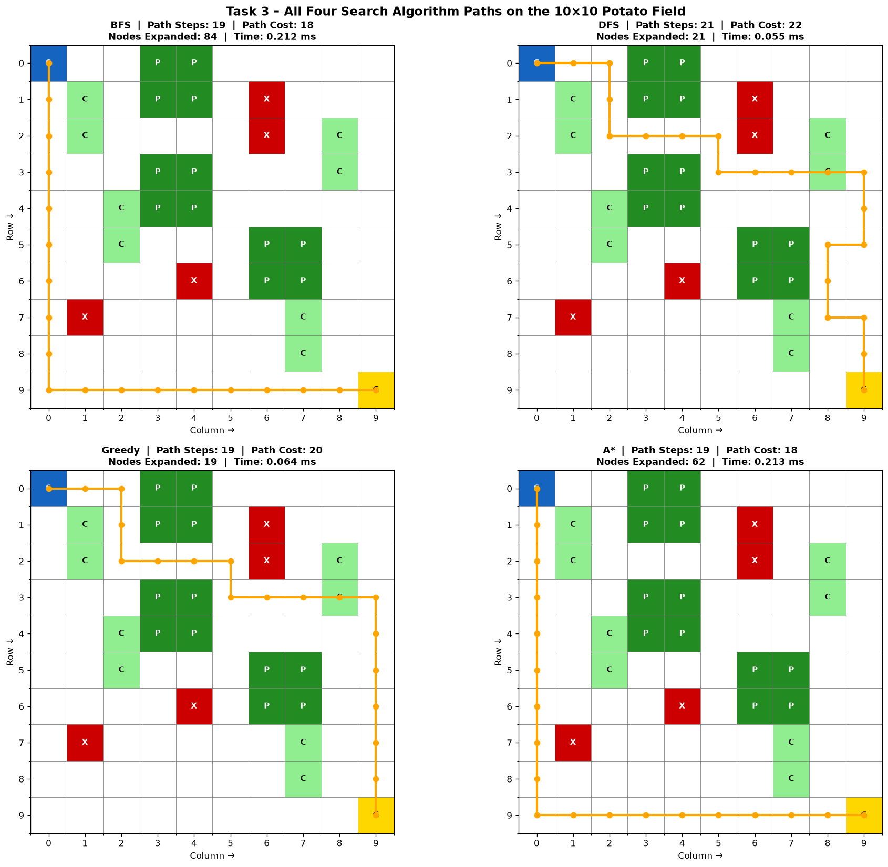
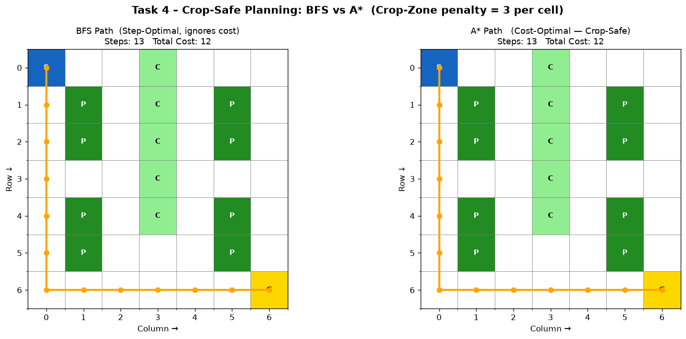
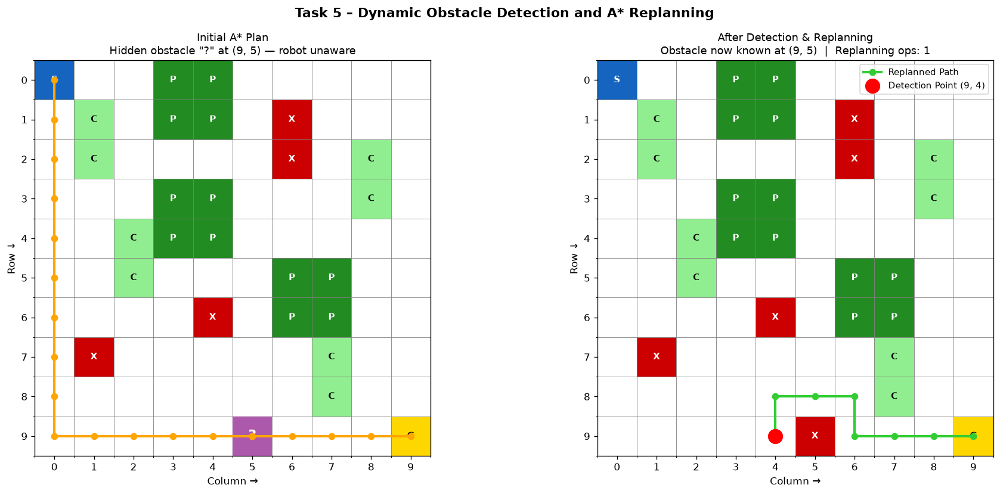
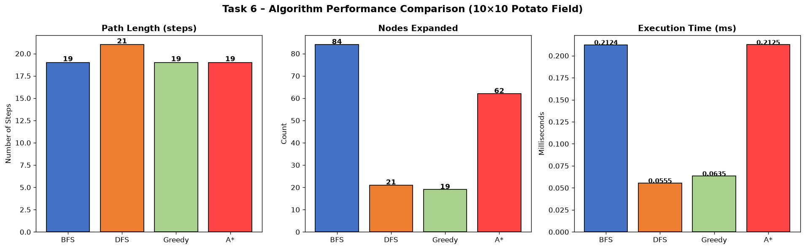

# AI-Based Crop-Safe Path Planning for an Autonomous Potato-Field Robot

**Subject:** Artificial Intelligence | **Institution:** IIIT Nagpur | **Instructor:** jchakole@iiitn.ac.in

---

## Group Members

| # | Name | Roll Number |
|---|------|-------------|
| 1 | Nakul Bhadade | BT24CSA047 |
| 2 | Pranjal Baghel | BT24CSA052 |
| 3 | Ness Dubey | BT24CSA053 |
| 4 | Siddhi Dhoke | BT24CSA050 |
| 5 | Lakshuki Hatwar | BT24CSA063 |

**Work distribution:**
- **Nakul Bhadade** – Field environment setup and problem formulation (Tasks 1 & 2)
- **Pranjal Baghel** – BFS and DFS search algorithms (Task 3, Part A)
- **Ness Dubey** – Greedy Best-First Search and heuristic design (Task 3, Part B)
- **Siddhi Dhoke** – A* Search implementation and crop-safe path cost (Task 3 Part C & Task 4)
- **Lakshuki Hatwar** – Obstacle detection, dynamic replanning, and performance comparison (Tasks 5 & 6)

---

## Project Overview

This project implements an AI path-planning system for an autonomous robot navigating a potato field. The robot needs to travel from a start point to a destination while avoiding crop rows and hard obstacles, and minimising movement cost near crop-protection zones.

We model the field as a **10×10 2D grid** and implement four classical AI search algorithms to find the optimal route. We also simulate a scenario where the robot encounters an unknown obstacle mid-journey and dynamically replans its path using A*.

---

## Problem Setup

| Component | Details |
|-----------|---------|
| Grid size | 10 × 10 |
| Start position | (0, 0) — top-left |
| Goal position | (9, 9) — bottom-right |
| Robot movement | 4-directional: Up, Down, Left, Right |
| Blocked cells | Potato rows (1) and Obstacles (3) — robot cannot enter |
| Penalty cells | Crop-protection zones (2) — passable but costs 3 instead of 1 |
| Free cells | (0) — normal travel cost of 1 |

---

## Tasks

### Task 1 – Field Environment
Built a 10×10 NumPy grid representing the potato field. Each cell is one of six types:

| Type | Code | Description |
|------|------|-------------|
| Free Path | 0 | Normal travel |
| Potato Row | 1 | Blocked — actual crop rows |
| Crop-Protection Zone | 2 | Passable with penalty (cost = 3) |
| Obstacle | 3 | Blocked — stones, tools |
| Start | 4 | Robot start |
| Goal | 5 | Robot destination |

### Task 2 – Problem Formulation
Defined as a state-space search problem:
- **State:** `(row, col)` position on the grid
- **Initial state:** `(0, 0)`
- **Goal test:** `state == (9, 9)`
- **Actions:** Move Up / Down / Left / Right (one cell at a time)
- **Path-cost function:** 1 for free cells, 3 for crop-zone cells

### Task 3 – Search Algorithms

| Algorithm | Strategy | Optimal? | Complete? |
|-----------|----------|----------|-----------|
| BFS | Level-by-level (FIFO queue) | Yes (uniform costs) | Yes |
| DFS | Depth-first (LIFO stack) | No | Yes |
| Greedy Best-First | Min-heap on `h(n)` only | No | Yes |
| A* | Min-heap on `f(n) = g(n) + h(n)` | Yes | Yes |

**Heuristic — Manhattan Distance:**

```
h(n) = |row_n - row_goal| + |col_n - col_goal|
```

This is admissible because the robot moves one cell at a time in 4 directions, so Manhattan distance is always a lower bound on the true remaining cost. This guarantees A* finds the optimal solution.

### Task 4 – Crop-Safe Planning
The step cost function assigns a cost of 3 to crop-protection zone cells. Because A* minimises total path cost, it naturally avoids these zones when a cheaper free-path detour exists. Potato rows and hard obstacles are completely blocked and cannot be entered.

### Task 5 – Obstacle Detection and Replanning
We simulate a scenario where one obstacle is hidden from the robot's initial map. During travel, when the robot's next planned cell is blocked in the real world, it:
1. Updates its known map to mark the obstacle
2. Calls A* again from its current position to find a new route
3. Continues on the replanned path to the goal

No physical sensors are needed — the detection is simulated by comparing the robot's plan against the true field.

### Task 6 – Performance Evaluation

| Algorithm | Path Length | Path Cost | Nodes Expanded | Time (ms) | Goal Reached |
|-----------|-------------|-----------|----------------|-----------|--------------|
| BFS | 19 | 18 | 84 | ~0.19 | Yes |
| DFS | 21 | 22 | 21 | ~0.05 | Yes |
| Greedy | 19 | 20 | 19 | ~0.06 | Yes |
| A* | 19 | 18 | 62 | ~0.19 | Yes |

**Obstacle experiment:** Hidden obstacle at `(9, 5)` — replanning operations: **1**

**Observations:**
- BFS finds the fewest steps but does not account for travel cost
- DFS is fast and uses very few nodes, but its path is not optimal in cost
- Greedy expands the fewest nodes due to heuristic guidance, but is not cost-optimal
- A* achieves the minimum path cost and guarantees the optimal solution

---

## Screenshots

### Task 1 — Field Grid


### Task 3 — All Algorithm Paths


### Task 4 — Crop-Safe Planning (BFS vs A*)


### Task 5 — Obstacle Detection and Replanning


### Task 6 — Performance Comparison


---

## Libraries Used

| Library | Purpose |
|---------|---------|
| `numpy` | Grid construction and array operations |
| `matplotlib` | Field visualisation and performance charts |
| `collections` | FIFO deque for BFS |
| `heapq` | Priority queue for Greedy and A* |
| `time` | Execution time measurement |

Install dependencies:
```bash
pip install -r requirements.txt
```

---

## How to Run

### Option 1 — Open in VS Code (Recommended)
1. Clone or download this repository
2. Open the folder in VS Code
3. Open `AI_CropSafe_PathPlanning.ipynb`
4. Select your Python interpreter (top-right corner)
5. Click **Run All** or step through cells with **Shift + Enter**

> The notebook already has all outputs saved inside it, so you can read and review everything without running it.

### Option 2 — Jupyter in browser (if VS Code doesn't work)
```bash
pip install -r requirements.txt
python -m notebook AI_CropSafe_PathPlanning.ipynb
```
Then click **Kernel → Restart & Run All**.

### Option 3 — Command line only (no Jupyter needed)
```bash
pip install -r requirements.txt
python generate_screenshots.py
```
Runs all 6 tasks, prints the performance table in the terminal, and saves all 5 plots to `screenshots/`.

### Option 4 — Google Colab (zero local setup)
Upload `AI_CropSafe_PathPlanning.ipynb` to [Google Colab](https://colab.research.google.com) and click **Runtime → Run All**.

---

## Repository Contents

```
AI_CropSafe_PathPlanning_GroupXX/
├── AI_CropSafe_PathPlanning.ipynb   # Main notebook with all tasks
├── generate_screenshots.py          # Standalone runner
├── requirements.txt                 # Python dependencies
├── README.md                        # This file
└── screenshots/
    ├── task1_field_grid.png
    ├── task3_all_algorithms.png
    ├── task4_crop_safe_planning.png
    ├── task5_obstacle_replanning.png
    └── task6_performance_comparison.png
```

---

## Submission

| | |
|-|-|
| **To** | jchakole@iiitn.ac.in |
| **Subject** | AI Group Coding Assignment Submission – Group XX |
| **Include** | Group number, names and roll numbers, GitHub link, representative contact |
